# Card Place — A safer way to buy and sell trading cards

<p align="center"><b>🇬🇧 English</b> &nbsp;|&nbsp; <a href="README.fr.md">🇫🇷 Français</a></p>

**A secure exchange to invest in trading cards the way you invest in a stock**: the buyer's money is held in escrow by a Soroban contract until the card has been checked, the card itself lives in a vault and trades as a Stellar token, and every sale leaves a public, verifiable price history.

Built for HackMeridian 2026 (Stellar, Lisbon). Everything described as *deployed* below runs on Stellar testnet, with real transactions you can open in the explorer.

**Submission video:** https://youtu.be/GI39-gaAhnQ (3 min)

**Live demo:** https://card-place-demo-337081298177.europe-west1.run.app (web marketplace; `/mobile-app/` for the phone version, open it at 390 px wide). The on-chain card record comes from the appraisal agent, which is not deployed yet, so that one block shows as unavailable; prices and trades are read live from Stellar Horizon.

## The pitch in pictures

Frames from the submission video. Every terminal line and every transaction shown is real, on Stellar testnet.

<p align="center">
  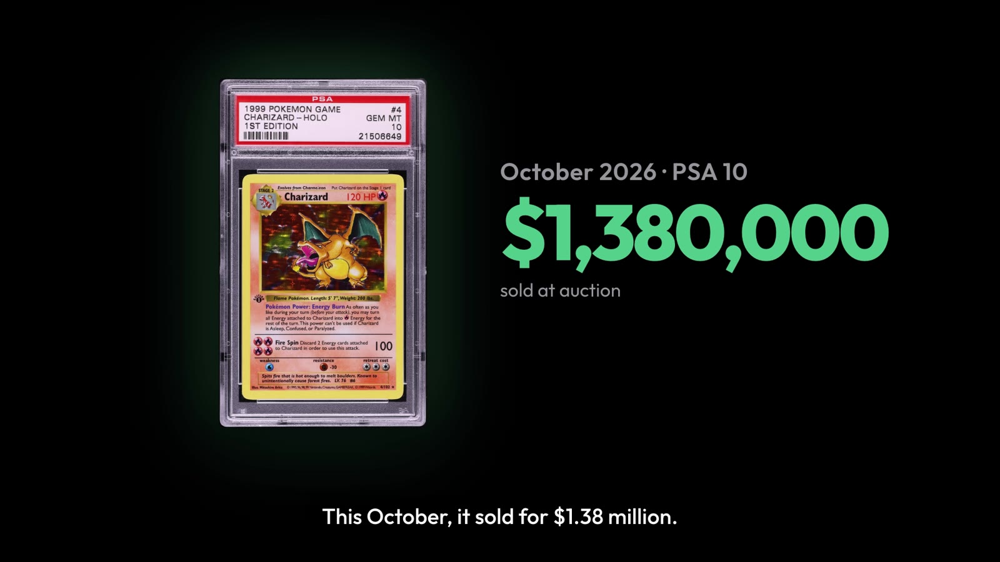
  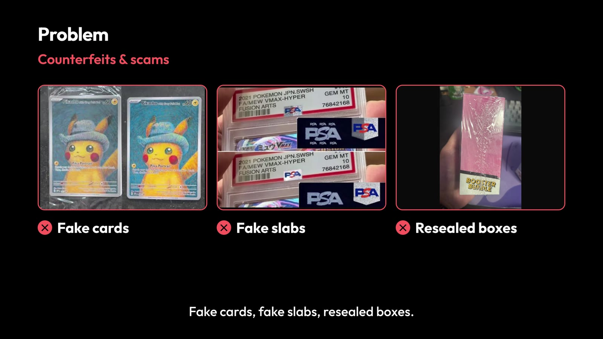
</p>
<p align="center">
  
  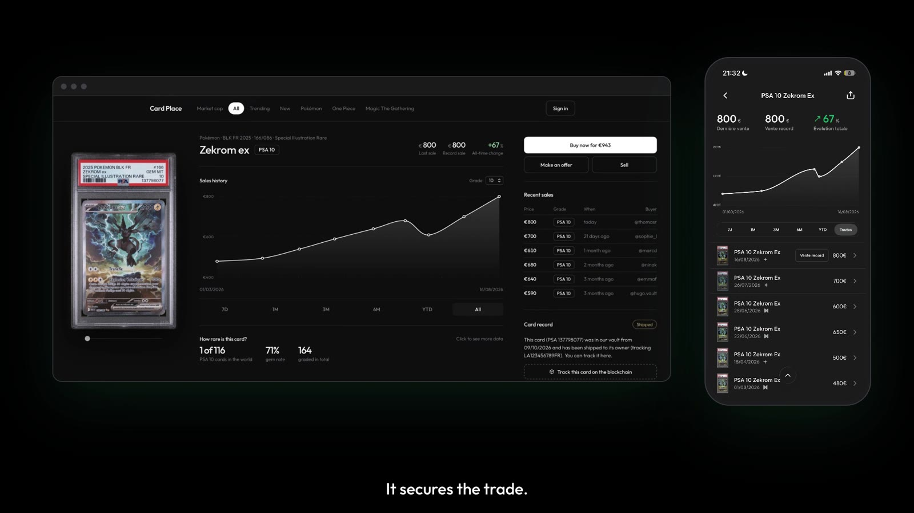
</p>
<p align="center">
  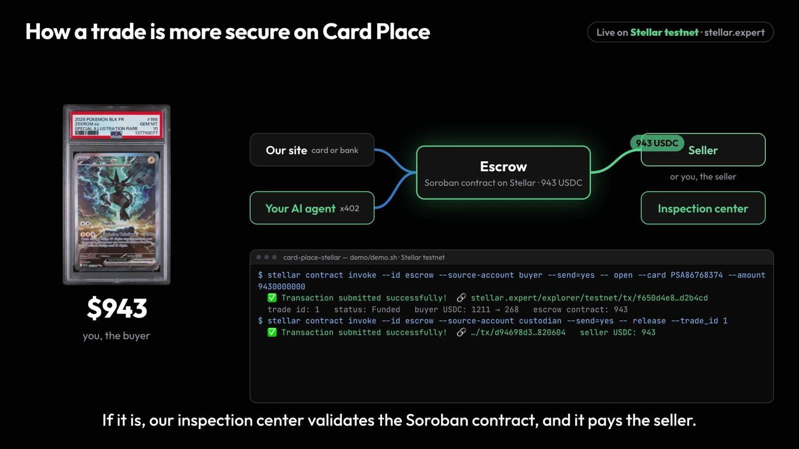
  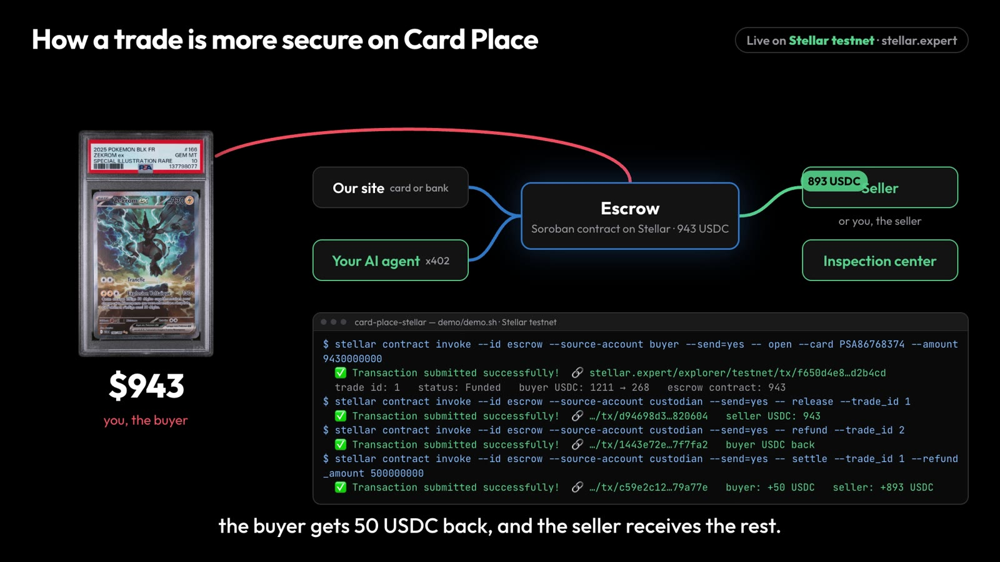
</p>
<p align="center">
  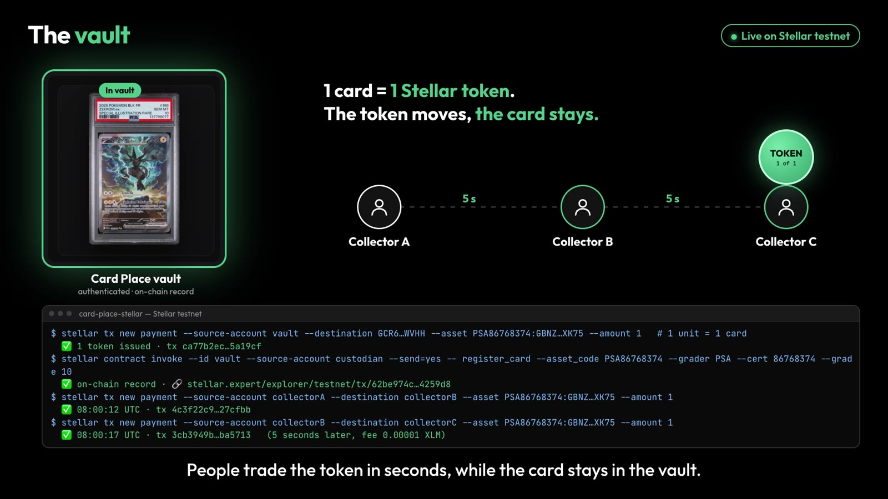
  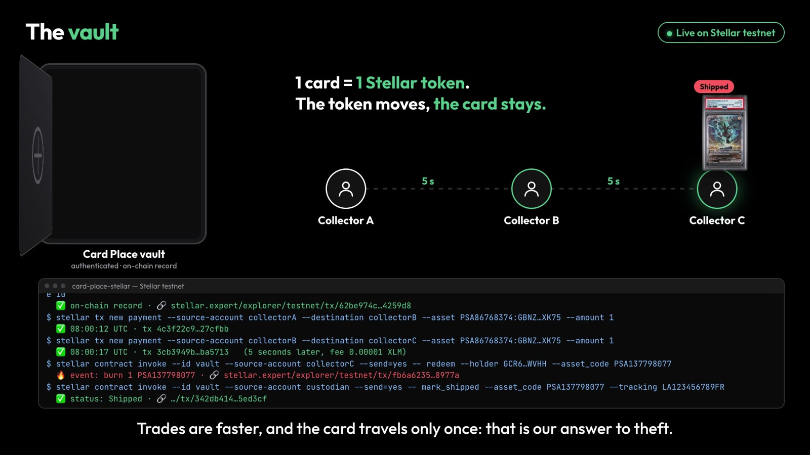
</p>
<p align="center">
  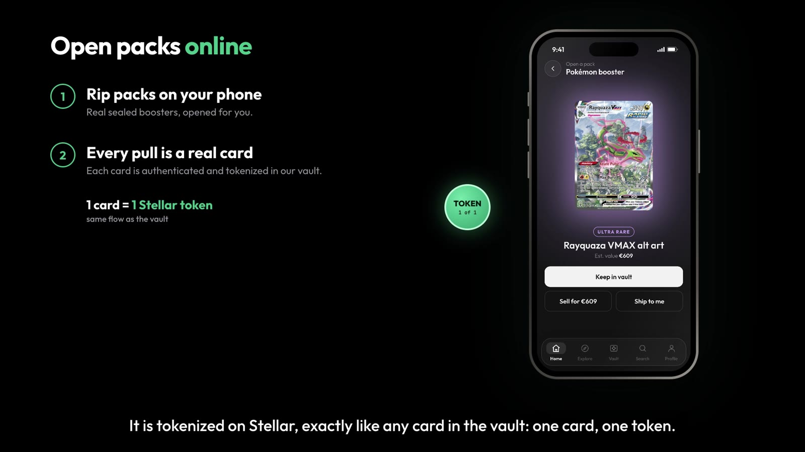
  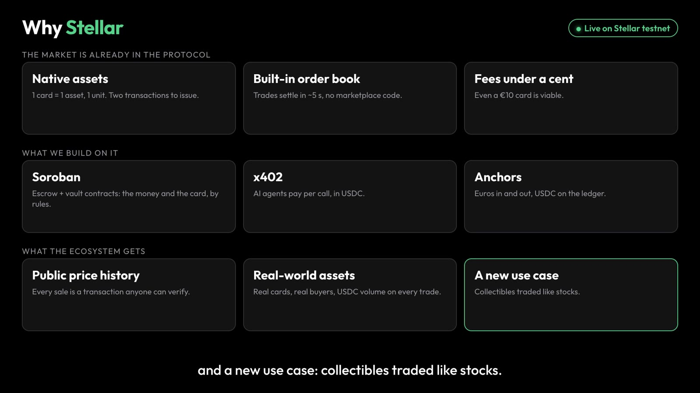
</p>

## The problem

Trading cards have become a real investment, and the market is growing fast: $2.8B in North America and $1.3B in Europe in 2025 for trading card games alone (Global Market Insights). A 1st Edition Charizard PSA 10 sold for $1.38M in October 2026.

I am a collector, and the co-founder of [Graded Card Shop](https://gradedcardshop.fr): we buy and sell graded cards and have made 300+ sales without any advertising, only through platforms like Vinted and eBay. Day to day, this market has three problems:

1. **Counterfeits and scams.** Fake cards, fake slabs with copied labels, booster boxes resealed and sold as new. Every transaction means trusting a stranger again.
2. **Theft.** Parcels stolen in transit, insurance that doesn't always pay, burglaries that target collectors.
3. **Scattered data.** Sales happen on many platforms that don't share their history. There is no reliable price history, no way to compare a card to others or to the market as a whole, the way you would for a stock or a crypto.

**Card Place targets all cards, but starts with graded cards** (PSA, PCA, BGS): already authenticated, sealed in a slab, identified by a unique certificate number. Their condition is frozen and their price is liquid. It is the easiest market to secure first.

## What Card Place does

<p align="center">
  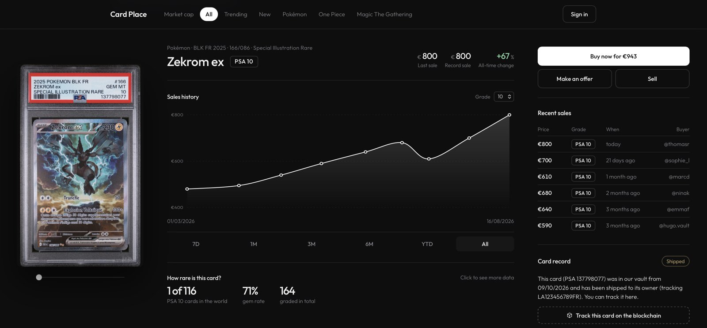
</p>

Card Place does two things.

**It secures the trade.** The buyer's USDC is locked in an **escrow contract**, not with the seller and not with Card Place. The seller only ships once the deposit is visible on-chain. The card goes to our vault, where we inspect it. If it is what was sold, we confirm and the contract pays the seller; if not, the contract refunds the buyer. If the card is genuine but the seller is at fault (late shipping…), we decide how much goes back to the buyer and the contract pays the rest to the seller. If nothing happens before the deadline, the buyer can refund themselves. No trust needed between buyer and seller, and the money can only ever go to one of them.

**It gives you the full picture before you buy.** Every card has its page: price history, recent sales, rarity, and how it compares to the rest of the market. The data comes from the chain, so anyone can verify it.

Sellers can also leave their card in the vault. It is then represented by **a native Stellar asset** (code = certificate number, 1 unit issued). The token trades on the native order book in 5 seconds for a fraction of a cent, and the physical card only travels once: when the final holder calls `redeem()`, returns the token and receives the card.

### The user journey

Buyer:

1. I want this card: I open an escrow and deposit the price in USDC. → `escrow.open`
2. The seller ships the card to Card Place. We inspect it, and an AI agent cross-checks the slab against the grader's record.
3. Valid card: the contract pays the seller. → `escrow.release`. Not valid: I get my money back. → `escrow.refund`
4. I receive the card, or I leave it in the vault as a token I can resell without shipping.

Seller:

1. I list my card at my price, and accept or reject offers.
2. I only ship once the buyer's money is locked on-chain.
3. If my card is in the vault, it is a token: I can sell it as many times as I like without touching it.

### Security, concretely

- **Card Place rules, the contract sets the limits.** We inspect the card, so we decide: pay the seller (`release`), refund the buyer (`refund`), or split the deposit when the card is genuine but the seller is at fault (`settle`, where we choose the amount refunded). The contract bounds that power: only the custodian key can rule; the money can only go to the buyer or the seller, never anywhere else; the seller is only paid if the vault holds the card; a trade is ruled once and cannot be reopened; every decision is a public transaction showing the amount refunded. If we never rule, the buyer refunds themselves after the deadline. The reason for a decision is not recorded on-chain yet.
- **No AI in transaction validation.** Validating a payment, releasing escrow, burning a token: deterministic, tested, readable code. AI is used elsewhere: a coding agent to build and deploy the contracts, and an appraisal agent paid per call that never touches funds.
- **Only the custodian can create a card token**, and only after the physical inspection. A card that isn't in the vault has no token. A fake, a stolen photo or a resealed slab produce nothing.
- **The reference photo is taken by the custodian**, not the seller, and its SHA-256 is stored on-chain: nobody can swap it afterwards.
- **The AI agent identifies the card; it does not replace physical authentication.** It cross-checks the grader's public record, the slab label read from the photo, and the on-chain record. If any one diverges, a human reviews it.

## What runs on testnet today

Two complete on-chain journeys, executed with a real card from our stock (2025 Pokémon BLK FR Zekrom ex #166, PSA 10, certificate 137798077):

**The vault.**
1. The custodian authenticates the card, puts it in the vault and registers it on-chain: certificate, grade, SHA-256 of the photo. → `register_card`
2. The token moves freely: payments, order book, trustline = the receiver's consent.
3. An AI agent, paid 0.01 USDC per call via **x402 on Stellar**, checks the photo against the contract, reads the slab label, compares it with the on-chain record and the grader's certificate, and rates the condition.
4. The holder returns the token and requests the card. → `redeem` (the SAC burns the token)
5. The custodian confirms shipping with the tracking number. → `mark_shipped`

**The escrow** (`demo/demo.sh` replays it end to end).
1. A second real card from our stock, a Lugia V PSA 10 (cert 86768374), enters the vault. → `register_card`
2. The buyer deposits 943 USDC for it. → `open` — the USDC leaves the buyer's account for the contract's.
3. The custodian checks the card and releases the funds. → `release` — the escrow reads the vault, sees the card `InVault`, and pays the seller 943 USDC.
4. The trap: a buyer deposits 50 USDC for the Zekrom, which already left the vault (`Shipped`). The custodian tries to release: **the contract refuses** (`CardNotInVault`). No card in the vault, no payment.
5. The custodian refunds. → `refund` — the buyer gets their 50 USDC back.
6. A partial refund: 943 USDC locked for the Lugia, which arrives late because of the seller. → `settle` with 50 USDC back to the buyer: the seller receives 893 USDC, the buyer 50, in one transaction.

Both contracts are small, fully commented, and covered by unit tests (11 for the vault, 18 for the escrow).

## Why Stellar

Replace Stellar with a database and you need a trusted intermediary to hold balances and publish prices, plus settlement delays and fees on every resale. On Stellar:

- **The escrow is a contract, not a company.** Soroban holds the USDC; the rules are public code.
- **A card token is not a contract.** One card = asset code + issuer, 1 unit. Issuing takes two transactions.
- **The market is already in the protocol.** The native order book trades the card against XLM or USDC with no marketplace code, and it is public: the end of opaque prices.
- **Every sale is a public transaction.** A card's price history can be verified by anyone, without depending on the platform.
- **A trustline is consent.** Nobody receives a card without having accepted it.
- **Fees make a €10 card viable**, which is economically impossible elsewhere.
- **Fiat goes in and out through anchors** (SEP-24, MoneyGram): the buyer pays in euros, the ledger settles in USDC.
- **x402 on Stellar** lets agents pay in the same currency as collectors, with fees sponsored by the facilitator.

[StockX](https://stockx.com) proved the order book + authentication model for sneakers, without a blockchain. [Courtyard](https://courtyard.io) tokenises PSA cards on Polygon. Card Place's angle is the European niche (PCA, PSA FR), a seller who is also the custodian, low-priced cards that fees exclude elsewhere, an escrow that protects both sides, and the public price as the product.

## Architecture

<p align="center">
  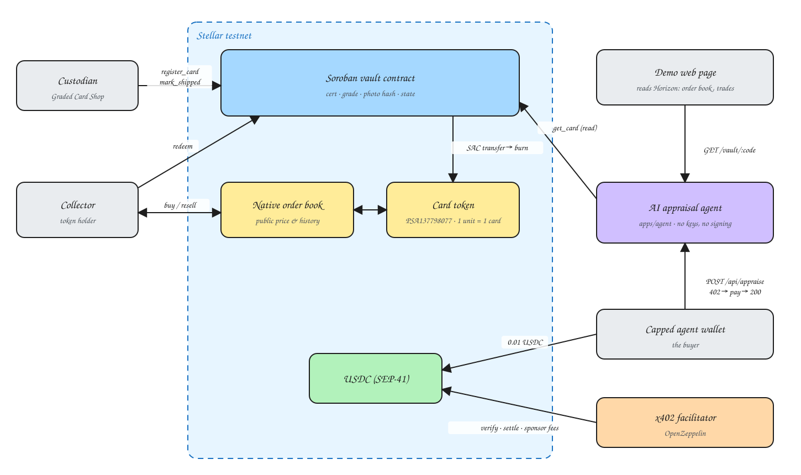
</p>

Source: [`docs/architecture.excalidraw`](docs/architecture.excalidraw), editable at [excalidraw.com](https://excalidraw.com). The custodian writes the record, the market lives on the native order book, the escrow holds the USDC between buyer and seller, the agent reads the record and gets paid in USDC, and `redeem` burns the token and triggers shipping.

## Technical specs

### Contract `contracts/escrow` (Rust, `soroban-sdk` 28, target `wasm32v1-none`)

| Function | Auth | Inputs | Output | Effect |
|---|---|---|---|---|
| `__constructor(custodian, token, vault)` | deployment | `Address, Address, Address` | — | sets the custodian, the payment asset (USDC SAC) and the vault contract |
| `open(buyer, seller, card, amount, deadline_ledgers)` | buyer | `Address, Address, Symbol, i128, u32` | `Result<u32, Error>` | transfers `amount` from the buyer to the contract, creates the trade, state `Funded`. Returns the trade id. Errors `InvalidAmount` (3), `SameParty` (5) |
| `release(trade_id)` | custodian | `u32` | `Result<(), Error>` | asks the vault for the card's record; if it is not `InVault`, refuses with `CardNotInVault` (6) and nothing moves. Otherwise transfers `amount` from the contract to the seller, state `Released`. Errors `TradeNotFound` (1), `InvalidStatus` (2) |
| `settle(trade_id, refund_amount)` | custodian | `u32, i128` | `Result<(), Error>` | genuine card but a seller fault (late shipping…): returns `refund_amount` to the buyer and pays the rest to the seller, in one transaction, state `Settled`. Same vault check as `release`. Error `InvalidSplit` (7) if the part is not between 0 and `amount` |
| `refund(caller, trade_id)` | caller | `Address, u32` | `Result<(), Error>` | transfers `amount` back to the buyer, state `Refunded`. The custodian can call it any time; the buyer only after `deadline`. Error `NotExpired` (4) |
| `get_trade(trade_id)` | none | `u32` | `Result<Trade, Error>` | public read |

**`Trade` record.** `buyer`, `seller`, `card` (asset code of the card, link to the vault), `amount` (7 decimals), `refunded` (the part returned to the buyer), `status`, `opened_at`, `deadline` (ledger).

**Invariants.** A trade leaves `Funded` exactly once, to `Released`, `Settled` or `Refunded`. The amount that leaves the contract equals the amount deposited: buyer's part + seller's part. The seller can never trigger a refund. **The seller is only paid for a card the vault holds**: `release` reads the vault contract on-chain and refuses otherwise. 18 unit tests cover both paths, the deadline, the vault check, and every rejection.

### Contract `contracts/vault` (Rust, `soroban-sdk` 28, target `wasm32v1-none`)

| Function | Auth | Inputs | Output | Effect |
|---|---|---|---|---|
| `__constructor(custodian)` | deployment | `Address` | — | sets the custodian |
| `register_card(asset_code, token, grader, cert, grade, description, photo_hash)` | custodian | `Symbol, Address, Symbol, Symbol, u32, String, BytesN<32>` | `Result<(), Error>` | creates the record, state `InVault`. Error `CardAlreadyRegistered` (1) |
| `redeem(holder, asset_code)` | holder | `Address, Symbol` | `Result<(), Error>` | transfers 1 unit of the token (SAC) to the custodian, state `RedeemRequested`. Errors `CardNotFound` (2), `InvalidStatus` (3) |
| `mark_shipped(asset_code, tracking)` | custodian | `Symbol, String` | `Result<(), Error>` | state `Shipped`, stores tracking |
| `get_card(asset_code)` | none | `Symbol` | `Result<Card, Error>` | public read |

**Invariants.** Strict transitions `InVault → RedeemRequested → Shipped`. `redeem` requires the holder's auth, which covers the SAC `transfer`: nobody can return someone else's token. Custodian = issuer, so the transfer burns the token. 11 unit tests.

Both contracts keep their records in persistent storage with the TTL extended on every write (threshold 30 days, target 1 year). No `Vec`, no loops: constant cost per call.

### Agent `apps/agent` (Node 22, ESM, Express 5)

| Route | Price | Role |
|---|---|---|
| `GET /health` | free | service status |
| `GET /vault/:asset_code` | free | on-chain record, read through RPC simulation |
| `POST /api/appraise` `{ asset_code }` | 0.01 USDC via x402 | reads the record, checks the photo fingerprint; Claude reads the label, compares it with the record and the grader's certificate, rates the condition and estimates value |

**x402 on Stellar.** `@x402/express` + `@x402/stellar`, testnet facilitator hosted by OpenZeppelin, SEP-41 USDC. The client signs a Soroban authorization entry; the facilitator rebuilds the transaction, sponsors the fees and settles. The client refuses to sign above the `AGENT_MAX_USD_PER_PAYMENT` cap.

**The AI agent holds no Stellar key and signs no transaction.** It proposes; the holder and the custodian decide.

## Deployed on testnet

| What | Address / transaction |
|---|---|
| Custodian and deployer | [`GBNZP4YND7GXOM26YNBOAXIMTEMKNHDX7CQ5VZOJ3VKW7HDJSQR3XK75`](https://stellar.expert/explorer/testnet/account/GBNZP4YND7GXOM26YNBOAXIMTEMKNHDX7CQ5VZOJ3VKW7HDJSQR3XK75) |
| **Escrow contract** | [`CC2NP5O5E5L4463WLWTEPXOR3KEBYY7FMQMZT56TYLBJUVCP3DJHLG2O`](https://stellar.expert/explorer/testnet/contract/CC2NP5O5E5L4463WLWTEPXOR3KEBYY7FMQMZT56TYLBJUVCP3DJHLG2O) |
| Escrow deployment | [`4115cf…5edffe`](https://stellar.expert/explorer/testnet/tx/4115cf66549a88a1f4de54311ac1b271cbdd3d3334a3084f2df79feba95edffe) |
| USDC (testnet, SAC) | [`CBIELTK6YBZJU5UP2WWQEUCYKLPU6AUNZ2BQ4WWFEIE3USCIHMXQDAMA`](https://stellar.expert/explorer/testnet/contract/CBIELTK6YBZJU5UP2WWQEUCYKLPU6AUNZ2BQ4WWFEIE3USCIHMXQDAMA) |
| Buyer | [`GCR6HZKROPDQY3KZBSC27KKYEB7RAJRDWEIEUQYIXHUA6D6WOVXTWVHH`](https://stellar.expert/explorer/testnet/account/GCR6HZKROPDQY3KZBSC27KKYEB7RAJRDWEIEUQYIXHUA6D6WOVXTWVHH) |
| Seller | [`GDSMQRA65ZTZBFP57USVK6QNFZNZTCAPCTEDUYUKXEMSOIZAGKI4ZUPM`](https://stellar.expert/explorer/testnet/account/GDSMQRA65ZTZBFP57USVK6QNFZNZTCAPCTEDUYUKXEMSOIZAGKI4ZUPM) |
| `register_card` Lugia V PSA 10, cert 86768374 | [`62be97…4259d8`](https://stellar.expert/explorer/testnet/tx/62be974cbcf8fdfc9253dbaa2b0be49218c74145906d46485ffa3bb8574259d8) |
| Trade 1 · `open`, 943 USDC locked | [`f650d4…d2b4cd`](https://stellar.expert/explorer/testnet/tx/f650d4e823d9428abb6bd0681c149aacf7417cb6b2126fa6cbb349e883d2b4cd) |
| Trade 1 · `release`, seller paid | [`d94698…820604`](https://stellar.expert/explorer/testnet/tx/d94698d3a9ad61da578589b1ef799f14f01111718b43f533374baff235820604) |
| Trade 2 · `open`, 50 USDC locked for a card not in the vault | [`446b8e…dddbf2`](https://stellar.expert/explorer/testnet/tx/446b8e79f15ba21f794a0996a7c6e479cc90fa0205265389f21d4089addddbf2) |
| Trade 2 · `release` refused by the contract (`CardNotInVault`) | simulation fails, nothing is sent: run `demo/demo.sh` to see it |
| Partial refund · `open` 943 USDC for the Lugia | [`8f28c8…fcf01e`](https://stellar.expert/explorer/testnet/tx/8f28c848bdd3b281a43f3ff8216f7ed8f5e11440ef102bee825f736ee0fcf01e) |
| Partial refund · `settle`, 50 USDC → buyer, 893 USDC → seller | [`c59e2c…79a77e`](https://stellar.expert/explorer/testnet/tx/c59e2c1237f13747d7e6464e9308b22937d1214d209e2ac209991564af79a77e) |
| Trade 2 · `refund`, buyer reimbursed | [`1443e7…7f7fa2`](https://stellar.expert/explorer/testnet/tx/1443e72e998656d3ae39ab81a296f9666ccd583bb903f6d3e68aa262407f7fa2) |
| **Vault contract** | [`CDN5OOWTOYKEXMH5CDG7APQRQEHGFRKWQEAHQR5XR3643YOM2YEMEMRO`](https://stellar.expert/explorer/testnet/contract/CDN5OOWTOYKEXMH5CDG7APQRQEHGFRKWQEAHQR5XR3643YOM2YEMEMRO) |
| Vault deployment | [`5833d9…978d1`](https://stellar.expert/explorer/testnet/tx/5833d98dd4230adee7f78feb8b34dcf8d8a190cb453c7b0dbf224c1ab25978d1) |
| Card asset `PSA137798077` (SAC) | [`CASKFD5AFFRLUEW6YJUQRSTXJ7MQU7ZMUCMW254G4CR5QJ45Q5DYNVKH`](https://stellar.expert/explorer/testnet/contract/CASKFD5AFFRLUEW6YJUQRSTXJ7MQU7ZMUCMW254G4CR5QJ45Q5DYNVKH) |
| `register_card` (custodian) | [`246cf5…6d32c`](https://stellar.expert/explorer/testnet/tx/246cf5ebeebd77fe2176ef1fa584334a9c6f0e0387e8eed37d45a8ed7526d32c) |
| `redeem` (collector, SAC `burn` event) | [`fb6a62…8977a`](https://stellar.expert/explorer/testnet/tx/fb6a6235c2cac014ed0e1e846945e1cf5b574b25458ba55e0e9946e0e398977a) |
| `mark_shipped` (custodian) | [`342db4…5ed3cf`](https://stellar.expert/explorer/testnet/tx/342db414c65cf3bf04648dde4fd87a280d883b2644c287fd64b733ada25ed3cf) |
| x402 payment settled by the facilitator | [`4709b9…763c4`](https://stellar.expert/explorer/testnet/tx/4709b937d086eef100fe09bc760bde81f9d84887a7fff12f14beec9268e763c4) |

The SHA-256 of `docs/psa-137798077-front.jpg` is `e274a654…0abfa`, stored on-chain.

## Reproduce

Prerequisites: Rust + the `wasm32v1-none` target, [Stellar CLI](https://developers.stellar.org/docs/tools/cli) 28, Node 22, funded testnet identities (`stellar keys generate moi --network testnet --fund`, same for `collectionneur` and `vendeur`).

### 1. Contracts

```sh
cargo test                                   # 29 tests: 11 vault + 18 escrow
stellar contract build                       # target/wasm32v1-none/release/{card_vault,card_escrow}.wasm

MOI=$(stellar keys address moi)
stellar contract deploy \
  --wasm target/wasm32v1-none/release/card_vault.wasm \
  --source-account moi --network testnet --alias vault \
  -- --custodian "$MOI"

USDC=$(stellar contract id asset --asset USDC:GBBD47IF6LWK7P7MDEVSCWR7DPUWV3NY3DTQEVFL4NAT4AQH3ZLLFLA5 --network testnet)
stellar contract deploy \
  --wasm target/wasm32v1-none/release/card_escrow.wasm \
  --source-account moi --network testnet --alias escrow \
  -- --custodian "$MOI" --token "$USDC" --vault "$(stellar contract alias show vault --network testnet)"
```

The two `deploy` commands register the `vault` and `escrow` aliases in your Stellar CLI config; everything below uses them. The contracts we deployed (table above) only accept our custodian key, so the write calls (`register_card`, `release`…) run against your own deployment. To read ours instead (`get_card`, `get_trade`): `stellar contract alias add vault --id CDN5OOWTOYKEXMH5CDG7APQRQEHGFRKWQEAHQR5XR3643YOM2YEMEMRO --network testnet` and `stellar contract alias add escrow --id CC2NP5O5E5L4463WLWTEPXOR3KEBYY7FMQMZT56TYLBJUVCP3DJHLG2O --network testnet`.

### 2. The escrow cycle

Or run everything at once, with the explorer link opened at each step: `bash demo/demo.sh` (bash, not `sh`). `OPEN_LINKS=0` keeps the links in the terminal; `PRICE_USDC=9 TRAP_USDC=1` lowers the amounts (default 943 + 50 USDC on the buyer's side, the 50 come back). The script checks the identities and aliases first and tells you what is missing.

The buyer and the seller both need a USDC trustline (`stellar tx new change-trust --source-account <who> --line USDC:GBBD47IF6LWK7P7MDEVSCWR7DPUWV3NY3DTQEVFL4NAT4AQH3ZLLFLA5 --network testnet`), and the buyer some testnet USDC ([Circle faucet](https://faucet.circle.com), Stellar network): 993 USDC for the demo as written, or lower the amounts.

```sh
COL=$(stellar keys address collectionneur); VEN=$(stellar keys address vendeur)

# the escrow only pays for a card the vault holds: the custodian registers it first (Lugia V PSA 10, cert 86768374)
stellar contract invoke --id vault --source-account moi --network testnet --send=yes -- \
  register_card --asset_code PSA86768374 --token CDRINTY4HMKL52OPNN3V5HXWIXRZXKZ4TKCMRWM24VVWVLUTH2ZWNHYZ \
  --grader PSA --cert '"86768374"' --grade 10 --description '"2022 Pokemon SWSH FR Lugia V #186 Silver Tempest"' \
  --photo_hash fea44be57a1038c49a0f092207bb31436c066f38060fccd1d2ec84842d9dad26

# the buyer locks 943 USDC for the card (deadline ≈ 7 days of ledgers)
stellar contract invoke --id escrow --source-account collectionneur --network testnet --send=yes -- \
  open --buyer "$COL" --seller "$VEN" --card PSA86768374 --amount 9430000000 --deadline_ledgers 120960
# → 1  (trade id)

# the custodian checks the card and pays the seller
stellar contract invoke --id escrow --source-account moi --network testnet --send=yes -- release --trade_id 1

# or, genuine card but late shipping: 50 USDC back to the buyer, the rest to the seller
stellar contract invoke --id escrow --source-account moi --network testnet --send=yes -- settle --trade_id 1 --refund_amount 500000000

# or, if the card fails inspection, refunds the buyer
stellar contract invoke --id escrow --source-account moi --network testnet --send=yes -- refund --caller "$MOI" --trade_id 1

# public read
stellar contract invoke --id escrow --source-account moi --network testnet -- get_trade --trade_id 1
```

### 3. The card: a native asset, a SAC, a holder

```sh
stellar tx new change-trust --source-account collectionneur --line "PSA137798077:$MOI" --network testnet
stellar tx new payment --source-account moi --destination "$COL" \
  --asset "PSA137798077:$MOI" --amount 10000000 --network testnet          # 1 unit = 1 card
stellar contract asset deploy --asset "PSA137798077:$MOI" --source-account moi --network testnet --alias card_psa137798077
```

### 4. The vault cycle

```sh
# the custodian registers the card (hash = sha256 of docs/psa-137798077-front.jpg)
stellar contract invoke --id vault --source-account moi --network testnet --send=yes -- \
  register_card --asset_code PSA137798077 --token CASKFD5AFFRLUEW6YJUQRSTXJ7MQU7ZMUCMW254G4CR5QJ45Q5DYNVKH \
  --grader PSA --cert '"137798077"' --grade 10 \
  --description '"2025 Pokemon BLK FR Zekrom ex #166 Special Illustration Rare"' \
  --photo_hash e274a6542ed20a6121176b169f09bf56c8a58ea62653109a9d553aa073a0abfa

# the collector returns the token and requests shipping
stellar contract invoke --id vault --source-account collectionneur --network testnet --send=yes -- \
  redeem --holder "$COL" --asset_code PSA137798077

# the custodian confirms shipping
stellar contract invoke --id vault --source-account moi --network testnet --send=yes -- \
  mark_shipped --asset_code PSA137798077 --tracking '"LA123456789FR"'
```

Without `--send=yes`, the call is only simulated and never reaches the ledger.

### 5. The AI agent and the x402 API

```sh
cd apps/agent
npm install
cp .env.example .env     # VAULT_CONTRACT_ID, X402_PAY_TO, X402_FACILITATOR_API_KEY, ANTHROPIC_API_KEY, AGENT_SECRET_KEY
```

- Free testnet facilitator key: `curl https://channels.openzeppelin.com/testnet/gen`
- The paying account needs a USDC trustline and some testnet USDC.

```sh
node scripts/x402-smoke.mjs                       # real x402 payment, no AI: 402 → 200 + receipt
npm start                                         # server on :3000
curl localhost:3000/vault/PSA137798077            # free
node scripts/pay-and-appraise.mjs PSA137798077    # the agent pays 0.01 USDC and receives the appraisal
```

### 6. The marketplace: web page and mobile app

Plain HTML, no framework, no build step.

```sh
node demo-web-page/serve.mjs                           # http://localhost:8080/demo-web-page/  and  /mobile-app/  (PORT=8081 if 8080 is taken)
sh demo-web-page/seed-market.sh                        # places a sell order and a buy order on the Stellar DEX
```

- **Web** (`demo-web-page/`): market cap ranking by TCG and by card, the Zekrom card page with sales history chart, rarity, recent sales, card record read from the contract, live buy price from the Stellar order book.
- **Mobile** (`mobile-app/`): home with vault value, explore by card or by TCG, card page with price history, vault, pack opening. Open it at 390 px wide, or on a phone on the same network.
- The card record is read live through the agent (`GET /vault/:code`); the buy price and the token's transactions are read live from Horizon. Sales history, population, the market table and the ranking are demo data in `demo-web-page/data/`.

## What is real, what remains

| In this repo, verified on testnet | Next |
|---|---|
| **Escrow contract**: `open` locks the buyer's USDC, `release` pays the seller, `refund` reimburses on dispute or after the deadline. Both paths executed on-chain | The monitoring program, no AI: listens to the carrier and on-chain events, triggers `release` or `refund` by the contract's rules; disputes go to a human |
| Vault contract, full cycle registered → returned → shipped with a real card | Several real cards from our stock, live trading on the order book |
| Card = native asset + SAC, token burned on `redeem` | Connected wallet (Freighter), fiat payment through an anchor |
| x402 payment on Stellar settled on-chain by the facilitator | The agent that buys for a collector within their spending limit |
| AI appraisal agent: on-chain read, SHA-256 check, structured output | Certificate lookup with the grader (PSA API, PCA page) |
| Web page and mobile app: on-chain record and order book read live, chart, population, ranking | Buy and sell from the page, through the escrow; sales history indexed from the token's transactions |
| Pack opening on mobile (prototype, local randomness) | Verifiable on-chain draw |

Then: a physical fingerprint of the card (high-resolution scan under fixed lighting, hash on-chain, re-scan on exit) or a tamper-proof NFC seal on the slab, and raw cards through the authentication and grading service at vault intake.

## Structure

```
contracts/escrow/src/lib.rs   # the escrow contract, commented
contracts/escrow/src/test.rs  # 18 tests
demo/demo.sh                  # the live demo: vault + escrow, end to end on testnet
contracts/vault/src/lib.rs    # the vault contract, commented
contracts/vault/src/test.rs   # 11 tests
apps/agent/src/               # config, vault, photos, appraise, paywall, payer, server
apps/agent/scripts/           # x402-smoke.mjs, pay-and-appraise.mjs
demo-web-page/                # web marketplace: index.html, styles.css, app.js, data/, img/, serve.mjs, seed-market.sh
mobile-app/                   # mobile marketplace: single index.html
docs/                         # reference photos of the card, screenshots, slides of the video, architecture diagram (.excalidraw + .svg)
README.fr.md                  # this README in French
AGENTS.md                     # context for coding agents
```
